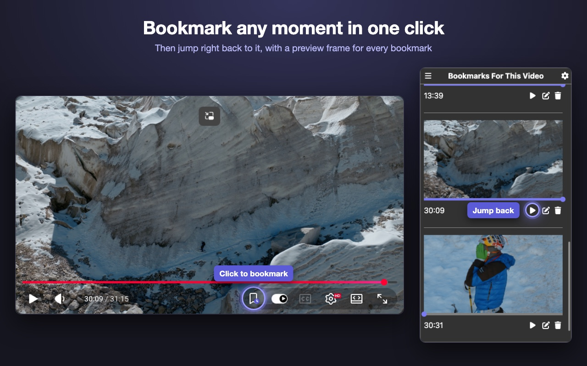
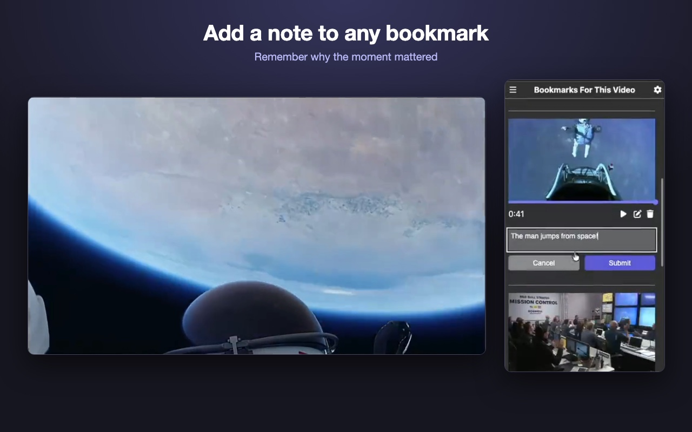
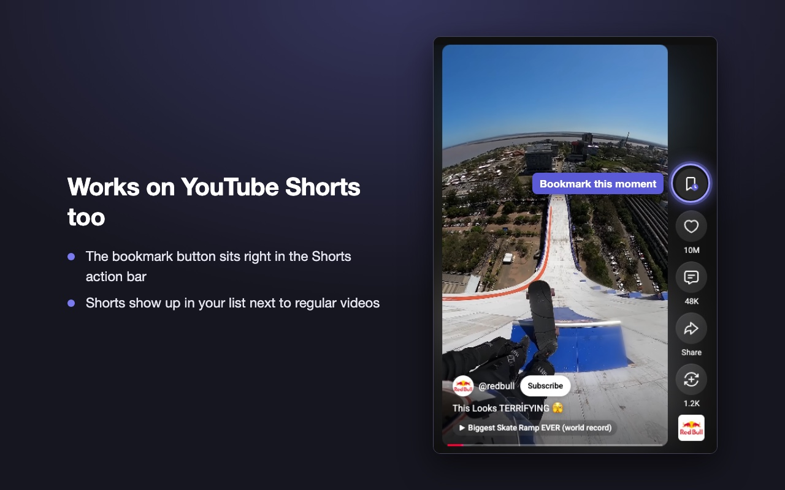
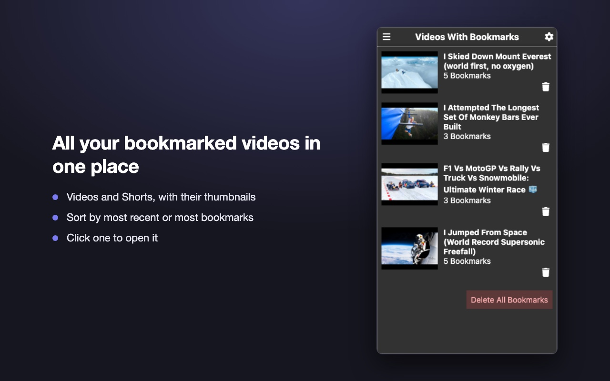
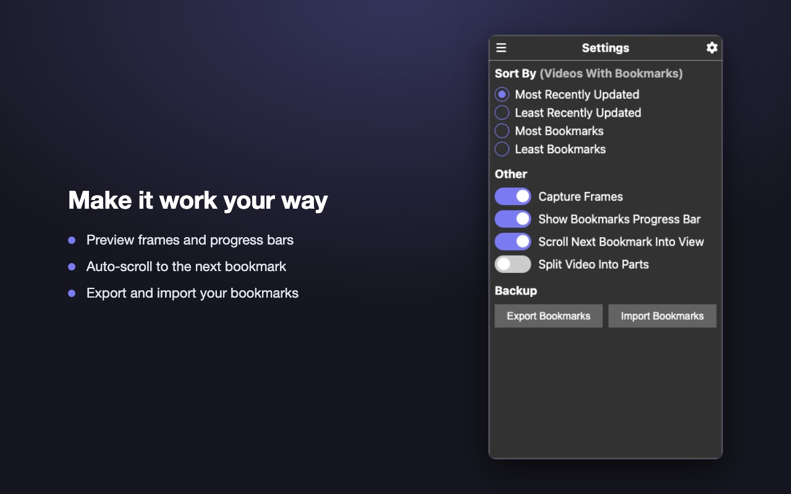

  

<h1 align="center">Markback</h1>

  <strong>Timestamp Bookmarks for YouTube™</strong> 
  Bookmark moments in YouTube videos and Shorts, add notes, and jump back to them in one click.

<!-- TODO: Replace "#" with the Chrome Web Store link once the extension is published. -->

  <a href="https://chromewebstore.google.com/detail/markback-%E2%80%93-timestamp-book/ocekekkakaidhegjiddndegpphboaema"><strong>Get it on the Chrome Web Store</strong></a>

  

  
  

  
  

## Features

**Save**

- Bookmark the current moment with one click using the button in the YouTube player.
- Works on regular videos and Shorts.
- Add a note to any bookmark.

**Revisit**

- See every bookmark for the video you're watching, with a preview frame of each moment.
- Play from any bookmark with one click.
- A progress bar under each bookmark shows how close the video is to reaching it.
- The list can automatically scroll to the next bookmark as the video plays.
- Optionally split the video into parts at your bookmarks. The player then shows "Part X/X" and the time within the current part.

**Organize**

- See every video you've bookmarked, sorted by most or least recently updated, or by number of bookmarks.
- Delete a single bookmark, all bookmarks for a video, or everything.

**Back up**

- Export all your bookmarks to a file and import them on another computer.

**Accessible**

- Everything in the popup works with the keyboard and screen readers.

## How to use

1. Open any YouTube video or Short.
2. Click the **bookmark button** in the player (a ribbon with a small clock) to save the current moment.
3. Click the **Markback icon** in Chrome's toolbar to see your bookmarks. Click one to jump back to it.

## Settings

Open the popup and click the gear icon.

| Setting | What it does | Default |
| --- | --- | --- |
| Sort By | How the "Videos With Bookmarks" list is sorted. | Most Recently Updated |
| Capture Frames | Show a preview frame of the video at each bookmark. | On |
| Show Bookmarks Progress Bar | Show a bar under each bookmark that fills up as the video gets closer to it. | On |
| Scroll Next Bookmark Into View | Automatically scroll the list to the next bookmark while the video plays. | On |
| Split Video Into Parts | Treat the sections between bookmarks as parts. The player shows "Part X/X" and the time within the current part. | Off |
| Export / Import Bookmarks | Save all your bookmarks to a file, or load them from one. | |

## Privacy

Markback doesn't collect or send any data. Your bookmarks and settings are stored in your own Chrome storage and synced only through your own Chrome profile. See the full [privacy policy](PRIVACY.md).

## FAQ

**Where are my bookmarks stored?**
In Chrome's sync storage. If you're signed in to Chrome with sync turned on, they show up on your other computers too.

**How do I move my bookmarks to another computer?**
If Chrome sync is on, they move automatically. Otherwise, use **Export Bookmarks** in Settings, then **Import Bookmarks** on the other computer.

**Is there a limit to how many bookmarks I can save?**
Chrome's sync storage is small: about 100 KB in total and about 8 KB per video. That's enough for a lot of bookmarks, but very long notes use it up faster. Export your bookmarks every now and then as a backup.

**Why didn't the popup open after I added a bookmark?**
Chrome can't open the popup while the video is in fullscreen. The bookmark is still saved, so just click the Markback icon after leaving fullscreen.

## Feedback

Found a bug or have an idea? [Open an issue](https://github.com/curlos/markback/issues).

---

YouTube is a trademark of Google LLC. Markback is not affiliated with or endorsed by YouTube or Google.
